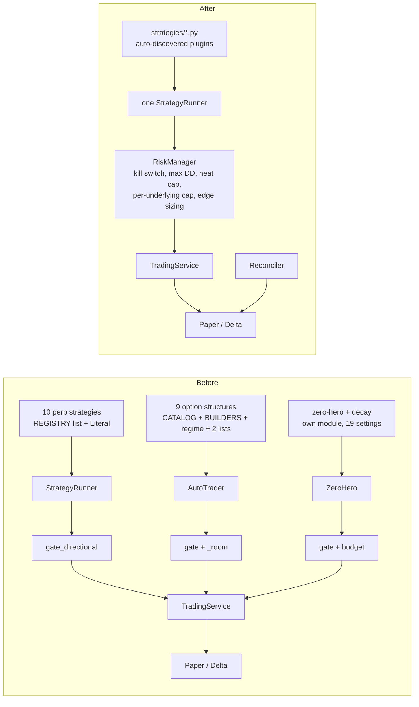

# 00 — Summary

Review of `Celery-Strategies-Analysis` (branch `trading_system`), 2026-11-07. Detail in 01–05.
The review below was written before any code changed; Phase 6 has since been implemented (`06_implementation.md`).

## Read this first
- **There is no Celery, Redis or Postgres in this repo.** It is one FastAPI process with an in-process scheduler and SQLite. For a single-user bot that is the right design; this review recommends *not* adding Celery/Redis/Postgres/Docker (`04` §4).
- **No strategy has demonstrated an edge.** 47 closed trades in total; automatic trades are −55.63 USD over 10 trades. The only statistically meaningful results are negative: Supertrend (≈ 400 trades per symbol, every walk-forward fold losing) and the 9/15 EMA cross.
- The execution core is good: idempotent orders, safe leg ordering, fail-closed live switch, measured-edge sizing, 372 passing tests.

## Top 10 issues

| # | Severity | Issue | Where |
|---|---|---|---|
| 1 | Critical | A crash mid-entry/exit leaves a structure `opening`/`closing` forever: broker blocked, UI cannot close it, a filled Delta perp may have no stop | `trading/service.py:417,566,729`, `guard.py:63` |
| 2 | Critical | Exchange positions and orders are never reconciled with the database | `brokers/delta.py`, `engine.py` |
| 3 | Critical | Nothing stops a second engine process from double-trading | `engine.py:3` |
| 4 | High | Telegram bot token written to logs via httpx INFO | `notify/notifier.py:91`, `main.py:43` |
| 5 | High | "Close all" is not a kill switch: auto-trading stays on and re-opens | `trading/service.py:779` |
| 6 | High | Eight UI actions place orders or arm live automation without confirmation | `05_ui_review.md` §6 |
| 7 | High | Selling-edge check fails open when realised vol is missing | `options/assess.py:101` |
| 8 | High | No portfolio-level exposure cap; families count slots separately | `service.py:376`, `autotrader.py:99` |
| 9 | High | Known-losing strategies and unbounded short options are on by default | `settings.py:75,84` |
| 10 | High | Adding a strategy touches 3–6 files (frontend copy already wrong) | `strategies/__init__.py`, `settings.py`, `options/*`, `strategy-picker.tsx` |

Close behind: Delta sizing uses `paper_leverage`; testnet bars mix into live history; tape filter can
lock itself out; `flow_breakout` reads a forming/stale tape bucket.

## Strategy verdicts

| Strategy | Family | Verdict |
|---|---|---|
| supertrend | perp | **Remove** — −0.11 to −0.16 R, all folds negative |
| ema_9_15 | perp | **Remove** — −0.43 R |
| trend_4h_short | perp | Keep with fixes (paper) |
| trend_4h_long | perp | **Remove** |
| ema_vwap | perp | Rework (make backtestable) |
| pcr_options | perp | **Remove** |
| value_area_return, sweep_absorption, exhaustion_fade, flow_breakout | perp | Rework (paper only, measure) |
| iron_condor, bull_put_spread, bear_call_spread, iron_butterfly | options | Keep with fixes (variance risk premium thesis) |
| short_strangle, short_straddle, short_call, short_put | options | **Remove** (unbounded; refused on live anyway) |
| long_straddle | options | **Remove** |
| zero_hero | options | **Remove** |
| expiry_decay | options | Rework (decouple from zero-hero) |

21 → 11 strategies; 79 settings → about 16 visible + 12 advanced.

## Before / after



## Roadmap

**Now (safety, days):**
1. Recover `opening`/`closing` on start; single-instance file lock.
2. Silence httpx INFO logs (token leak).
3. Stop all = auto off + close all.
4. Confirm every trade-placing UI action.
5. Fail-closed realised-vol check.
6. Delete the 10 "Remove" strategies and their settings.

**Next (structure, 1–3 weeks):**
1. `BaseStrategy` + auto-discovery, migrate `trend_4h_short` first with a golden-output test.
2. Option structures as plugins.
3. `RiskManager` with heat cap, per-underlying cap, max-drawdown stop; default risk 0.5 %.
4. Reconciler; exchange leverage on Delta; environment-keyed market data.
5. Overview screen; schema-generated strategy forms; settings cut.

**Later (evidence):**
1. Backtester matches live (trailing stop, funding per 8h, slippage); options replay on `data/chains/`.
2. ≥ 30 paper trades per kept strategy before any real money (the code already enforces this on Delta live).
3. Empirical return distribution instead of lognormal for POP/EV; event calendar.
4. Generate `frontend/src/lib/types.ts` from OpenAPI.

## To add a new strategy

Create one file in `backend/app/strategies/` (start from `_template.py`):

```python
# backend/app/strategies/donchian_4h.py
from pydantic import Field

from app.market.indicators import atr
from app.strategies.base import Context, Decision, Params, Strategy, bracket, none


class DonchianParams(Params):
    lookback: int = Field(55, ge=10, le=200, description="Bars whose high a close must clear")
    stop_atr: float = Field(2.0, ge=0.5, le=5, description="Stop this many ATRs below the entry")
    reward_r: float = Field(3.0, ge=1, le=10, description="Target this many times the risk")


class Donchian4h(Strategy):
    name = "donchian_4h"
    label = "4h Donchian breakout"
    summary = "A close above the highest high of the last `lookback` bars."
    stop_rule, target_rule = "stop_atr x ATR below", "reward_r x the risk"
    interval, lookback = "4h", 260
    Params = DonchianParams

    def decide(self, ctx: Context) -> Decision:
        bars = ctx.candles
        high = max(b.high for b in bars[-self.p.lookback - 1:-1])
        if bars[-1].close <= high:
            return none(f"no close above the {self.p.lookback}-bar high")
        risk = self.p.stop_atr * atr([b.high for b in bars], [b.low for b in bars], [b.close for b in bars], 14)[-1]
        stop = bars[-1].close - risk
        return Decision("buy", "broke the high", bars[-1].close, stop, bracket(1, bars[-1].close, stop, self.p.reward_r))
```

It appears on the Strategies page, off and paper-only, with a form built from its `Params`. Delete
the file and it is gone. It never touches the exchange: the trading service gates, sizes and executes.
The full guide is `docs/ADDING_A_STRATEGY.md`; the `add-strategy` project skill follows it.

## Documents
- `01_system_map.md` — structure, data flow, jobs, state, races, diagram, dead code
- `02_code_review.md` — findings by severity, testing, observability
- `03_strategy_review.md` — per-strategy analysis, backtests, portfolio risk, sources
- `04_target_architecture.md` — plugin system, risk manager, what not to add, migration plan
- `05_ui_review.md` — screens, five-second test, every setting, unconfirmed actions
- `06_implementation.md` — what Phase 6 changed, behaviour changes, what is left

## Implementation status

Phase 6 is implemented in the working tree, not committed: see `06_implementation.md` for what changed,
the behaviour changes to know before restarting, and what was left out.
