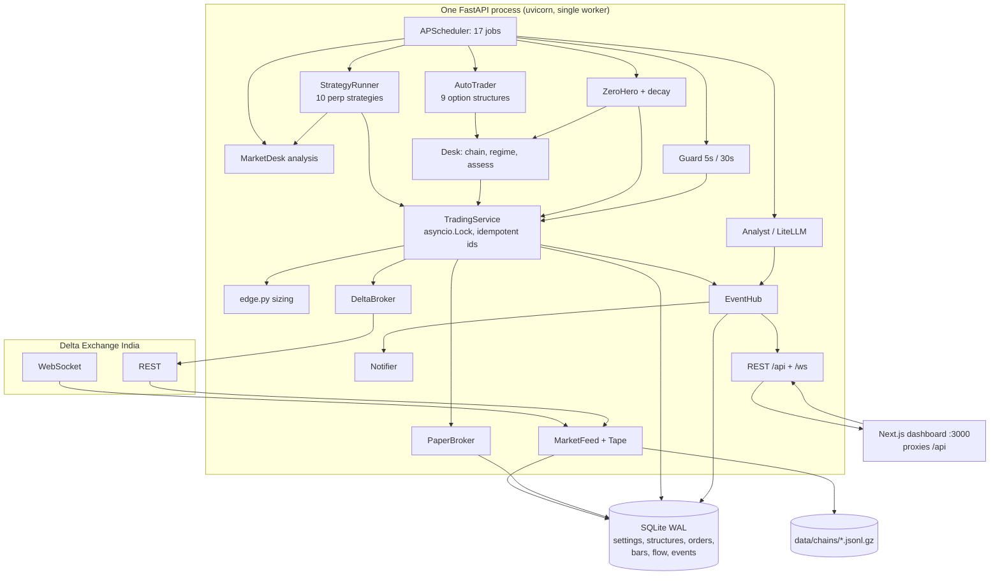

# 01 — System Map (Discovery)

Branch `trading_system`, 2026-11-07. Read-only. Backend tests: **372 passed**, ruff clean. Frontend:
`tsc`, `eslint` clean, **8 vitest** passed. `CLAUDE.md` exists and is largely accurate, so it was
not recreated.

> **The system is not Celery-based.** No Celery, Redis or Postgres anywhere in the repo. One FastAPI
> process hosts an `Engine` with an in-process APScheduler, an in-process event hub and SQLite.
> Only a stale docstring mentions Celery (`analysis/structure.py:4`). See §3.

## 1. Folder structure

```
backend/app/
  main.py            FastAPI app, auth middleware (PUBLIC_PATHS), lifespan starts the Engine
  config.py          process bootstrap (.env): DB path, host, PIN, CORS
  settings.py        all 79 runtime settings (Pydantic, stored in SQLite KV), fail-closed rules
  engine.py          wires every component, owns the 17-job schedule, the only writer
  errors.py          AppError / Refused / BrokerError / BrokerTimeout / NotFound
  core/
    db.py            SQLite (WAL), auto-ALTER for new columns, incremental vacuum
    models.py        every table (Structure, Leg, OrderRecord, Decision, SignalLog, Bar, FlowBar, ...)
    events.py        EventHub: persist event, fan out to /ws clients and subscribers
    logstore.py      WARNING+/ERROR log records -> deduplicated EventLog rows
    scheduler.py     APScheduler wrapper, job run status for the System page
    security.py      Argon2 PIN, HMAC session tokens, one-time WS tickets
  market/
    delta.py         the only Delta REST client (signing, retries, orders, tick rounding)
    feed.py          the only Delta WebSocket client + REST refresh + bar storage/cleaning
    tape.py          trade tape -> one footprint minute per symbol
    options.py       option quote parsing, chain arithmetic (ATM IV, skew, max pain, walls)
    indicators.py    EMA, RSI, ATR, Supertrend, realised/Parkinson/HAR vol, fold
    recorder.py      gzipped option-chain snapshots for backtests
  analysis/          market reading: bias, flow, profile, liquidity, zones, nearby, outlook,
                     structure (SMC), pulse, fibonacci, trendlines, insights, resample, service
  options/           pure option maths: pricing, strategies (catalog+builders), regime (scores),
                     assess (checks), gex, ideas, zerohero (scanner), decay (expiry spreads)
  strategies/        10 directional perp strategies, pure decide(); REGISTRY in __init__.py
  trading/
    service.py       the only code that opens/closes; idempotent ids; leg ordering; valuation
    desk.py          read side: chain, regime, plan, assess, realised vol, fees
    autotrader.py    options decision cycle
    runner.py        directional strategies on closed bars
    zerohero.py      expiry-day buy cycle + decay spread
    guard.py         exits every 5s, daily loss every 30s
    edge.py          measured edge in R -> size multiple; drawdown scaling
    risk.py          trading day, daily halts
    timing.py        zero-hero window
  brokers/           base.py (Protocol), paper.py, delta.py
  ai/                llm.py (LiteLLM with fallbacks), analyst.py (market brief only)
  notify/            Telegram + SMTP, daily report
  backtest/perp.py   backtest of a directional strategy on stored bars
  api/routes/        13 routers: auth, settings, market, desk, strategies, trading, portfolio,
                     auto, zerohero, ai, notifications, system, ws
backend/tests/       28 test files, fixture = one captured BTC chain, stub REST client
frontend/src/
  app/(dashboard)/   13 pages: desk (/), market, strategies, auto, zero-hero, positions,
                     performance, journal, orders, notifications, system, settings; login
  components/        desk, market, charts, positions, performance, journal, settings, layout, shared, ui
  lib/               api.ts (fetch wrapper), live.tsx (WebSocket -> SWR invalidation), types.ts (1,208 lines)
```

Repo noise: `ponytail/` (untracked plugin), `.agents/skills`, `.claude/skills` (UI/animation skills),
`skills/karpathy-guidelines`, `EXAMPLES.md`. Database backups `tradebuddy.before-dummy.db` and
`tradebuddy.pre-trend4h.db` sit in `backend/data/`.

## 2. Data flow

```
Delta WS (tickers, all_trades, l2 book) ─┐
Delta REST (chains 30s, bars 15m/1m)  ───┴─> MarketFeed ─> in-memory book (TTL: perp 30s, option 120s)
                                             │            └─> Bar table (15m 1y, 1m 30d), FlowBar (30d), chains/*.jsonl.gz
                                             └─ Tape ─> FlowBar minutes
Signal generation
  perp:    StrategyRunner (20s) folds 1m -> strategy interval, closed bars only -> Strategy.decide(Context)
           -> refusals (stopped-out today, against day bias >= 0.5) -> best R:R per symbol
  options: AutoTrader (15 min) -> pick expiry -> regime scores -> build + assess every enabled structure
           -> best by score, then edge
  zero-hero: windowed job (60s, 4h..2h before 12:00 UTC expiry) -> 5-gate scan; decay spread
Order decision
  sizing: risk_per_trade_pct x edge.scale x drawdown_scale (TradingService.risk_scale)
  gates:  TradingService.gate / gate_directional (broker active+ready, not halted, nothing unresolved,
          slots, quotes fresh, Delta-live bounded loss, account readable, margin)
Execution
  TradingService.open/open_directional under one asyncio.Lock: Structure+Legs saved "opening",
  bought legs first, IOC limit per leg, client_order_id = structure+leg+purpose+attempt,
  timeout -> lookup (1s,3s,10s) -> unknown -> structure "error" (broker blocked)
  Delta perp: reduce-only stop-market on the exchange; failure -> position closed
Position tracking
  Guard (5s): stop/target/trail for perps, expiry/time/zero-hero premise/TP/SL for options,
  defined-risk credits held to settlement; mark_pnl written to Structure; error structures retried
  Guard (30s): equity vs start-of-day -> halt + close_all on that broker
PnL
  Structure.pnl on close (entry_cash + exit_cash - fees); TradingService.stats() for Performance
UI
  EventHub -> /ws -> lib/live.tsx invalidates SWR keys; plus ~46 polling intervals
```

## 3. Scheduling, queues, workers

There are **no queues and no workers**. `Engine._schedule` (`engine.py:126-151`) registers 17 jobs on
APScheduler inside the FastAPI process, each with `max_instances=1`, `coalesce=True`,
`misfire_grace_time=30` (`core/scheduler.py:84`):

| Job | Every | Does |
|---|---|---|
| market.refresh | 30s | option chains and perps over REST |
| market.bars / market.base | 300s / 30s | store 15m / 1m bars |
| market.flow | 20s | store finished tape minutes |
| market.bias | 900s | record the day's bias |
| options.history | 60s | record options minute |
| market.chains | 300s | record every option quote |
| market.analyst | 300s | analysis + insights |
| strategies.run | 20s | directional runner |
| guard.structures | 5s | exits |
| guard.daily | 30s | daily loss limit |
| auto.cycle | `auto_interval_minutes` (15) | options auto-trader |
| zerohero.scan | `zh_scan_seconds` in window | zero-hero + decay |
| ai.brief | `ai_brief_minutes` (30) | LLM market brief |
| report.daily | cron `daily_report_hour` in `day_timezone` | daily report |
| live.prices | 2s | prices to dashboards |
| housekeeping | 3600s | retention, vacuum |

The backend **must run as a single worker** (`engine.py:3-5`); a second process would be a second
engine trading the same accounts. Nothing enforces that (no lock file).

Manual triggers bypass `max_instances`: `/api/system/jobs/{id}/run`, `/api/auto/run`,
`/api/zerohero/run` call the job function directly (`core/scheduler.py:123-127`), so a manual run can
overlap a scheduled one. `TradingService.lock` and structure ids prevent double orders; duplicate
decision rows are possible.

## 4. Where state lives

| State | Where | Notes |
|---|---|---|
| Settings | SQLite `kv["settings"]` + `Engine._settings` in memory | single writer; `auto_delta` forced off at start |
| Structures, legs, orders, decisions, signals, events, day risk, paper account | SQLite | source of truth for both brokers |
| Real Delta positions and orders | Delta exchange | **never reconciled with SQLite** (only `account()` reads positions for equity) |
| Live quotes, perps, book | `MarketFeed` memory, TTL-gated | |
| Bars, flow, options history | SQLite | **keyed by symbol only: testnet and live data mix** if `data_env` changes (`market/feed.py:170`) |
| Option chains | `backend/data/chains/*.jsonl.gz` | |
| Runner/auto/zero-hero "latest" readouts, guard counters, retry backoff, caches | process memory | lost on restart; harmless except `_breached` stop confirmations |
| PIN hash, session secret | SQLite KV | sessions not revocable |
| Delta product spec cache | `DeltaClient._products` | grows with every option symbol, never evicted |

**Races and duplicated state**
1. `update_exits` is a sync route (`api/routes/trading.py:56`) that runs in a threadpool and writes a `Structure` while the guard writes the same row on the event loop: lost update possible.
2. Sync routes iterate `feed.book` from threads while the WS handler mutates it (`market/feed.py:197`): "dictionary changed size during iteration" possible.
3. `TradingService.trail` computes the new stop outside the lock with a `Structure` loaded before it (`trading/service.py:631-653`); a dashboard close in between can leave it placing a stop for a closed position.
4. Two definitions of "today": bias/flow use UTC midnight; risk day, halts and "stopped out today" use `day_timezone` (IST).
5. Two direction models: `options/regime.direction` and `analysis/bias`.
6. Four bar folders with different semantics (`indicators.fold` drops the last bucket; `resample.fold` checks completeness; `flow.fold` keeps the forming bucket; `structure.resample` infers step from two candles).

## 5. Strategy registration

| Family | Registered | Configured | Triggered | Executed |
|---|---|---|---|---|
| 10 perp strategies | instance list in `strategies/__init__.py:14` + `Directional` Literal `settings.py:38` | `directional_strategies`, `strategy_symbols`; constants in each file | `strategies.run` every 20s, once per new closed bar | `TradingService.open_directional` |
| 9 option structures | `CATALOG` + `BUILDERS` (`options/strategies.py`), scores hand-written in `options/regime.py:146-202`, `STRATEGY_KEYS` + `Strategy` Literal in `settings.py` | `auto_strategies` + ~12 global option settings | `auto.cycle` every 15 min | `TradingService.open` |
| zero_hero, expiry_decay | `EXTRA` in `options/strategies.py:79`; code in `options/zerohero.py`, `options/decay.py`, `trading/zerohero.py` | 19 `zh_*` settings; decay rides on `zh_enabled` | windowed `zerohero.scan` | `TradingService.open` |

Per-broker switches `auto_paper` / `auto_delta` gate every family; `auto_options` (not in the UI) gates
the options auto-trader only.

## 6. External dependencies and secrets

| Dependency | Use |
|---|---|
| Delta Exchange India REST (`api.india.delta.exchange`, testnet `cdn-ind.testnet.deltaex.org`) | chains, bars, products, balances, positions, orders |
| Delta WebSocket | tickers, all trades, l2 book |
| LiteLLM -> any provider | market brief only, never trades |
| Telegram Bot API, SMTP | notifications |
| Python: fastapi, uvicorn, sqlmodel, httpx, websockets, pydantic-settings, argon2-cffi, apscheduler 3, litellm | |
| Frontend: Next.js 16, React, SWR, Tailwind v4, shadcn/ui, recharts, lightweight-charts | |

Secrets: Delta key/secret, Telegram token, SMTP password are **runtime settings stored in plain text
in SQLite** (`kv`), masked by `Settings.public()`; LLM keys stay in `.env`. Default PIN `242425` is in
`config.py:20` and `.env.example`. The Telegram token is written to stdout by httpx's INFO request log
(`notify/notifier.py:91` puts it in the URL; `main.py:43` logs at INFO).

Env vars (`config.py`, `.env.example`): `AUTH_PIN`, `DB_PATH`, `HOST`, `PORT`, `LOG_LEVEL`,
`SESSION_DAYS`, `CORS_ORIGINS`, `ENGINE_ENABLED`, provider keys (`MISTRAL_API_KEY`, ...).

## 7. Current architecture



## 8. Not understood, broken or dead

**Broken (verified)**
- `GET /trading/structures/{id}` requested by `frontend/src/components/performance/trades-table.tsx:36` does not exist.
- `Tape.trade` (`market/tape.py:81-85`) never updates its reference price after a rejected print: a junk first print, or a > 5 % move across an outage, rejects every later trade until restart.
- `flow.fold` keeps the forming 5m bucket and `MarketDesk.flow` has no freshness check; `flow_breakout` reads `delta`/`stacked` from that bucket, possibly hours old if the socket died.
- `outlook.pattern_record` uses a 15m bar length on 1h/1d bars (`analysis/outlook.py:360,461`) — mislabelled horizons; `patterns["1d"]` always empty.
- `pulse.py` hardcodes 15m but zero-hero feeds it 5m bars — magnitudes off by √3 (state ratios unaffected).
- `/api/desk/trendlines?limit=` is unclamped and runs O(swings² × bars) on the event loop the guard shares.
- `market_data`/`data_env` switch mixes testnet bars into the live history.

**Dead**
- `Decision.ai` column and the frontend "AI review" block (`auto/decision-row.tsx:34,89-107`); README still describes AI approving trades, contradicting invariant 11.
- `indicators.macd` (tests only), `reading._series`, `reading.TIMEFRAMES`, `liquidity.untouched`.
- In `MarketDesk.structure()`: trendlines, `levels_block`, smc and candle-estimated orderflow are computed every bar; no strategy reads them (display only).
- Stale docstrings: Celery (`structure.py:4`), docker compose (`outlook.py:344`), `verdict.py` (`pulse.py:35`), "no tape yet" (`orderflow.py:3`).

**Unclear**
- `trend_4h.py` cites a two-year, 10-perpetual test whose data is not in the repo.
- `guard.py:113-115` cites a chain replay of hold-to-settlement; no replay code exists in the repo.
- Whether Delta India charges option settlement fees (the decay spread and held credits settle; settlement is recorded with fee 0, `brokers/delta.py:76`).
